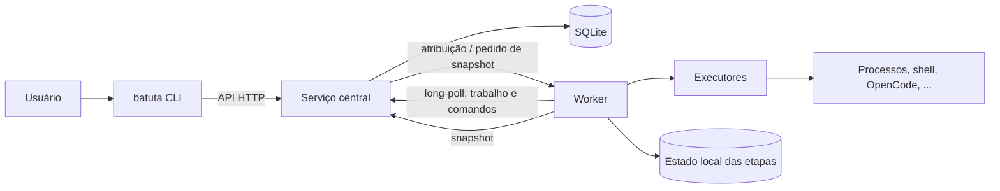

# Batuta

**Orquestração de tarefas distribuídas para ambientes heterogêneos.**

[Repositório principal](https://github.com/iniciativa-batuta/batuta-cli) ·
[Documentação](https://github.com/iniciativa-batuta/batuta-cli/tree/main/docs) ·
[Roadmap](https://github.com/iniciativa-batuta/batuta-cli/blob/main/docs/ROADMAP.md)

## A ideia

Batuta é um orquestrador de tarefas distribuídas com interface de linha de comando. Você
descreve o trabalho como uma **Task** versionada, com etapas explícitas; um serviço
central agenda uma **Execution** em um **Worker** compatível; e o worker executa as
etapas no ambiente certo, mantendo o estado real do que aconteceu.

O objetivo é ocupar o espaço entre "um script em uma máquina" e "uma plataforma inteira
de containers". Batuta é para quem tem algumas máquinas, ferramentas diferentes e quer
visibilidade e auditoria sem operar um cluster, um broker ou um banco distribuído.

## Como funciona

1. O serviço central define e agenda a execução.
2. O worker recebe o plano, executa as etapas e é dono do estado runtime delas.
3. O serviço central **consulta** esse estado por um protocolo explícito, com horário de
   observação e indicador de dado desatualizado.
4. A CLI mostra etapas, resultados, logs e artefatos. Sem percentuais inventados.

## Princípios

- **Propriedade explícita.** O centro manda no ciclo de vida de Task e Execution. O
  worker manda no estado runtime das etapas que executa.
- **Consulta, não notificação.** Progresso não é empurrado a cada transição. Heartbeat
  existe apenas para liveness.
- **Estruturado por padrão.** Comandos são executável + argumentos + diretório + ambiente.
  Shell é um executor explícito, desabilitado por padrão.
- **Falha é dado.** Etapa pulada tem motivo. Sucesso parcial não é sucesso. Nada é
  escondido.
- **Pequeno primeiro.** Go, `net/http`, SQLite, YAML e JSON. Sem broker, sem banco
  distribuído, sem service mesh.
- **Integrações nas bordas.** OpenCode, Git, Docker e shell são adaptadores. O domínio não
  depende deles.

## Repositórios

| Repositório | O que é | Status |
| --- | --- | --- |
| [batuta-cli](https://github.com/iniciativa-batuta/batuta-cli) | Produto: CLI, serviço central, worker, documentação e roadmap. | Pré-alfa |
| [.github](https://github.com/iniciativa-batuta/.github) | Perfil da organização, padrões e templates compartilhados. | Ativo |

## Status

O projeto está em **pré-alfa**, na fase de arquitetura e documentação. Ainda não há
implementação funcional. O [roadmap](https://github.com/iniciativa-batuta/batuta-cli/blob/main/docs/ROADMAP.md)
descreve as fases, os critérios de saída e as issues pequenas que compõem o MVP.

O MVP vai provar: criar uma task pela CLI, registrar um worker, atribuir uma execução,
executar etapas reais, consultar snapshots coerentes, aplicar perfis de continuidade e
recuperar de worker indisponível ou reiniciado.

## Como contribuir

Leia o [guia de contribuição](https://github.com/iniciativa-batuta/.github/blob/main/CONTRIBUTING.md)
e os [padrões da organização](https://github.com/iniciativa-batuta/.github/tree/main/docs/standards).
Issues e pull requests usam os templates padrão. Mudanças de comportamento exigem
documentação e testes na mesma alteração.

## Segurança

Não abra issue pública para vulnerabilidade. Siga a
[política de segurança](https://github.com/iniciativa-batuta/.github/blob/main/SECURITY.md).

## Licença

AGPL-3.0.

## Sobre o nome

**Batuta** é o nome de trabalho do produto. A disponibilidade jurídica e comercial da
marca ainda não foi confirmada. Nada aqui deve ser interpretado como liberação para
registro ou lançamento comercial.
